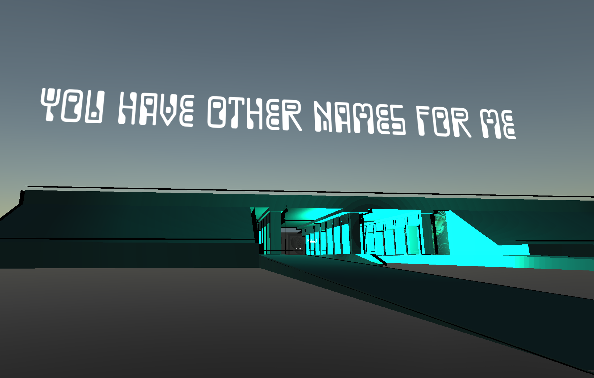

# Interactive-Narrative-
# Table of contents
[Background](#background)
[Overview](#overview)
[Main Prefabs](#prefabs)
[Models](#models2)
[Scripts](#scripts2)

[Art Installation](https://www.conncoll.edu/academics/internships-student-research/student-research-projects/immersive-virtual-environment-exploring-a-personal-campus-experience.html)

[Online Demo(Desktop Only)](https://interactivenarrative.azurewebsites.net/)

<a name = "background"/>

## Background
This was my senior capstone project. The project presentation had my application running on 4 laptops exploring the same environment together while the laptops streamed their displays on a larger screen The future of this project focuses on the power of personal narrative working along with the power of immersion. I want to develop a new way for people to tell and share stories.      

<a name = "overview"/>

# Overview

## Technical:
Up to 15 users can explore this environment  I created. You walk around with the standard "wasd" and mouse controls. Walk around the environment or go in a train to enter a new location faster. Along the way you will find boxes with floating text, simply walk into the box and the text will start cycling through parts of a poem. Each time you interact with a word cloud in the sky will also be changing. Future iterations will allow for you to submit your own messages to the word cloud for others to see. 

<a name = "upgrade"/>

## Running on a current Unity version
The project was built with Unity 5.3 and has been prepared to open in Unity 6 LTS (Built-in Render Pipeline):

- Open the project folder from Unity Hub with a Unity 6 LTS editor and accept the upgrade prompt. Unity rewrites the old asset files on first import, which takes a few minutes.
- Open `Assets/test44.unity` and press Play.
- The original multiplayer used UNet, which Unity has since removed. The project now runs **single-player**: `LocalPlayerSpawner` (on the `NETWORK` object) spawns the player prefab that `NetworkManager` used to spawn. Restoring multiplayer means porting to Netcode for GameObjects or Mirror.
- The `Standard%20Assets` folder (a URL-encoding mistake from an earlier upload) was merged back into `Standard Assets`.

## Continuous deployment
`.github/workflows/deploy-webgl.yml` builds the WebGL player with [GameCI](https://game.ci) on every push to `master` or `unity6-upgrade`, then deploys it to the `InteractiveNarrative` Azure Web App. Azure sign-in uses OIDC (no stored Azure password); `deploy/web.config` is added to the build so IIS serves the gzip-compressed files.

Repository secrets the workflow needs:
- `AZURE_CLIENT_ID`, `AZURE_TENANT_ID`, `AZURE_SUBSCRIPTION_ID`: the `interactive-narrative-github-deploy` app registration.
- `UNITY_LICENSE`, `UNITY_EMAIL`, `UNITY_PASSWORD`: a Unity Personal license; see [GameCI activation](https://game.ci/docs/github/activation).
